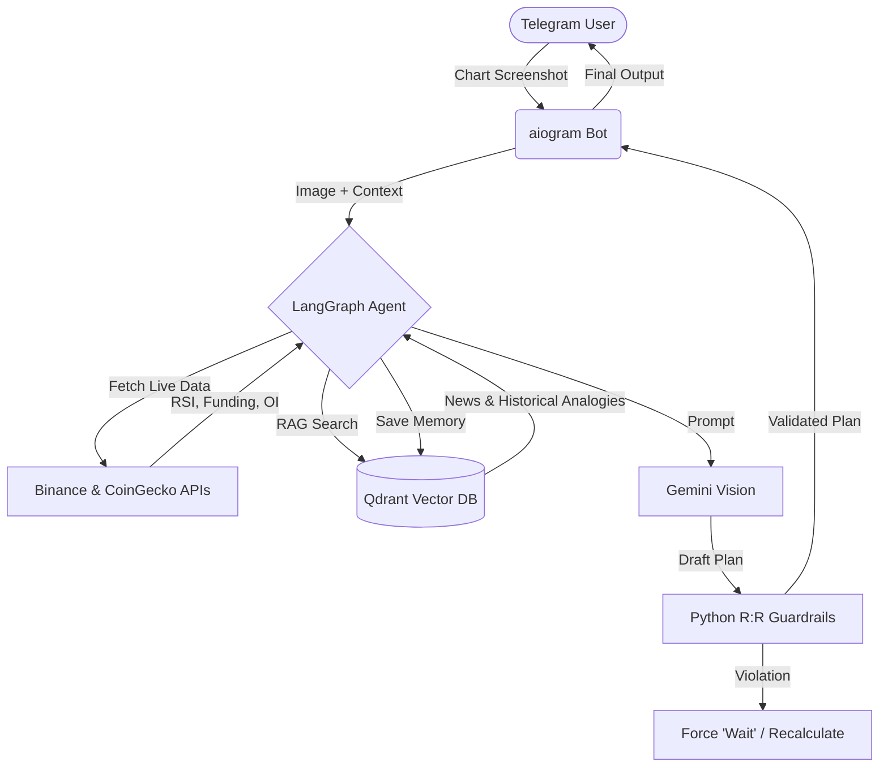

# RedPill: AI-Powered Trading Assistant (LLM + RAG)

An advanced AI agent designed to provide objective technical analysis, risk management, and portfolio tracking for crypto traders. Built to eliminate emotional trading by enforcing strict Risk/Reward (R:R) rules programmatically.

## Business Context
Manual chart analysis is subjective and prone to emotional bias. Traders often take trades with poor risk-to-reward ratios. This project solves that by combining the reasoning capabilities of Large Language Models (LLMs) with strict Python-based guardrails. The agent analyzes chart screenshots, pulls live market metrics, retrieves historical analogies (RAG), and generates numerical trading plans that physically cannot violate the user's risk parameters.

## Architecture



## Core Features

- **Strict Risk Management:** Python guardrails intercept the LLM's output and recalculate R:R ratios. If a plan has an R:R < 2.0, the bot automatically forces a "Wait" signal, preventing bad trades.
- **Vision-based Chart Analysis:** Uses Gemini Vision to read TradingView screenshots, identifying custom indicators, Fibonacci levels, and volume profiles.
- **Retrieval-Augmented Generation (RAG):** Connects to Qdrant to retrieve relevant historical market events (e.g., LUNA crash, FTX collapse) and news to ground the LLM in reality and prevent hallucinations.
- **Agentic Workflow:** Built with LangGraph, featuring a secondary "Devil's Advocate" LLM node to verify the initial analysis before execution.
- **Continuous Learning:** The agent records its own predictions and allows the user to update the actual outcome days later, building a long-term memory of successful and failed patterns.

## Tech Stack

- **LLM & Orchestration:** LangChain, LangGraph, Gemini 1.5, fastembed
- **Vector Database:** Qdrant
- **Backend & Bot:** Python 3.12, aiogram 3, FastAPI
- **Observability:** Langfuse
- **DevOps:** Docker, Docker Compose

## Quick Start (Local Deployment)

1. **Clone the repository:**
   ```bash
   git clone https://github.com/zhuckan/RedPill.git
   cd RedPill
   ```
   
2. **Configure environment variables:**
   ```bash
   cp .env.example .env
   # Add your Telegram, Gemini, and Exa API keys to the .env file
   ```
   
3. **Start Qdrant (Vector DB):**
   ```bash
   docker compose up -d qdrant
   ```
   
4. **Install dependencies:**
   ```bash
   python -m venv venv
   source venv/bin/activate
   pip install -r requirements.txt
   ```
   
5. **Initialize the Knowledge Base:**

   ```bash
   python -m scripts.load_mentor
   python -m scripts.load_events
   ```
   
6. **Run the bot:**

   ```bash
   python bot.py
   ```